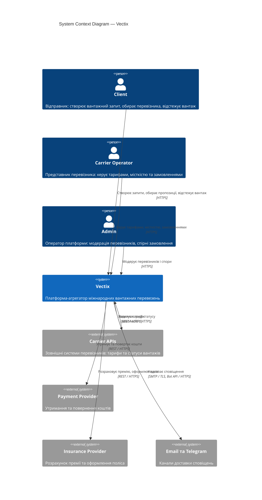

# РОЗДІЛ 2. ПРОЄКТУВАННЯ АРХІТЕКТУРИ СИСТЕМИ

Розділ містить архітектурну модель Vectix за методологією C4 Model (рівні Context, Container, Component), виконану за підходом Diagrams-as-Code (Mermaid.js), та зафіксовані архітектурні рішення. Усі елементи трасуються до вимог у [srs.md](./srs.md) та до рішень у [adr/](./adr/).

## 2.1. Контекстне та контейнерне моделювання системи (C4 Model)

### 2.1.1. C4 Level 1 — System Context

**Опис.** Система Vectix представлена єдиним блоком. Актори Client, Carrier Operator та Admin взаємодіють із системою через вебпорталі за протоколом HTTPS. Зовнішні системи: Carrier APIs (двобічна взаємодія: запит тарифів за REST / HTTPS та прийом подій статусу через Webhooks / HTTPS), Payment Provider та Insurance Provider (REST / HTTPS), Email та Telegram (SMTP / TLS та Bot API / HTTPS).

**Трасування:** користувачі та ролі — [SRS-FUN-01](./srs.md#srs-fun-01), [SRS-FUN-03](./srs.md#srs-fun-03); тарифи та статуси перевізників — [SRS-FUN-06](./srs.md#srs-fun-06), [SRS-FUN-15](./srs.md#srs-fun-15); оплата та страхування — [SRS-FUN-12](./srs.md#srs-fun-12); сповіщення — [SRS-FUN-19](./srs.md#srs-fun-19).

### 2.1.2. C4 Level 2 — Container

```mermaid
C4Container
    title Container Diagram — Vectix

    Person(client, "Client", "Відправник")
    Person(carrierOp, "Carrier Operator", "Представник перевізника")
    Person(admin, "Admin", "Оператор платформи")

    System_Boundary(vectixBoundary, "Vectix") {
        Container(clientPortal, "Client Portal", "Next.js", "Створення запитів, вибір пропозицій, відстеження")
        Container(carrierPortal, "Carrier Portal", "Next.js", "Тарифи, маршрути, місткість, замовлення, адміністрування")
        Container(gateway, "API Gateway", "NestJS", "Маршрутизація, перевірка JWT, RBAC, Rate Limiting")
        Container(identity, "Identity Service", "NestJS", "Реєстрація, OAuth 2.0 / OIDC, видача JWT")
        Container(shipment, "Shipment Request Service", "NestJS", "Прийом і валідація запитів, тарифікована вага")
        Container(quote, "Quote Engine Service", "NestJS", "Паралельне формування пропозицій")
        Container(scoring, "Quote Scoring Service", "FastAPI, Python", "Ранжування пропозицій, прогноз ETA")
        Container(carrierMgmt, "Carrier Management Service", "NestJS", "Тарифні сітки, маршрути, місткість")
        Container(order, "Order Orchestrator", "NestJS", "Saga оформлення замовлення")
        Container(payment, "Payment and Insurance Service", "NestJS", "Escrow, страхування")
        Container(tracking, "Tracking Service", "NestJS", "Прийом подій, CQRS read-model, SSE")
        Container(docs, "Document and Notification Service", "NestJS", "Накладні PDF, сповіщення, рейтинг")
        ContainerQueue(kafka, "Apache Kafka", "Kafka, KRaft", "Шина подій і команд Saga")
        ContainerDb(pg, "PostgreSQL", "PostgreSQL 16", "Окрема логічна БД на сервіс, outbox-таблиці")
        ContainerDb(redis, "Redis", "Redis 7", "Кеш пропозицій, лічильники Rate Limiting")
        ContainerDb(minio, "Object Storage", "MinIO, S3 API", "Документи PDF")
        Container(otel, "Observability Stack", "OpenTelemetry Collector, Prometheus, Grafana, Jaeger", "Трасування, метрики, дашборди")
    }

    System_Ext(carrierApis, "Carrier APIs", "Системи перевізників")
    System_Ext(paymentProvider, "Payment Provider", "Платіжний провайдер")
    System_Ext(insuranceProvider, "Insurance Provider", "Страховий провайдер")
    System_Ext(messaging, "Email та Telegram", "Канали сповіщень")

    Rel(client, clientPortal, "Використовує", "HTTPS")
    Rel(carrierOp, carrierPortal, "Використовує", "HTTPS")
    Rel(admin, carrierPortal, "Використовує", "HTTPS")

    Rel(clientPortal, gateway, "Запити API", "REST / HTTPS")
    Rel(clientPortal, gateway, "Потік статусів", "SSE / HTTPS")
    Rel(carrierPortal, gateway, "Запити API", "REST / HTTPS")
    Rel(carrierApis, gateway, "Події статусу", "Webhooks / HTTPS")

    Rel(gateway, identity, "Отримує публічні ключі JWKS", "HTTP / JSON")
    Rel(gateway, redis, "Лічильники Token Bucket", "RESP / TCP")
    Rel(gateway, shipment, "Маршрутизує запити", "gRPC / HTTP/2")
    Rel(gateway, quote, "Маршрутизує запити", "gRPC / HTTP/2")
    Rel(gateway, carrierMgmt, "Маршрутизує запити", "gRPC / HTTP/2")
    Rel(gateway, order, "Маршрутизує запити", "gRPC / HTTP/2")
    Rel(gateway, tracking, "Маршрутизує запити та SSE", "gRPC / HTTP/2")
    Rel(gateway, docs, "Маршрутизує запити", "gRPC / HTTP/2")

    Rel(identity, pg, "Зберігає облікові записи", "SQL / TCP")
    Rel(shipment, pg, "Зберігає запити та outbox", "SQL / TCP")
    Rel(shipment, kafka, "Публікує shipment.requested", "Kafka protocol / TCP")
    Rel(quote, kafka, "Споживає shipment.requested, публікує quotes.generated", "Kafka protocol / TCP")
    Rel(quote, carrierMgmt, "Запитує тарифні сітки", "gRPC / HTTP/2")
    Rel(quote, carrierApis, "Запитує тарифи", "REST / HTTPS")
    Rel(quote, scoring, "Передає пропозиції на ранжування", "REST / HTTP, JSON")
    Rel(quote, redis, "Кешує пропозиції", "RESP / TCP")
    Rel(quote, pg, "Зберігає пропозиції та outbox", "SQL / TCP")
    Rel(carrierMgmt, pg, "Зберігає тарифи та місткість", "SQL / TCP")
    Rel(carrierMgmt, kafka, "Споживає команди резервування, публікує результат", "Kafka protocol / TCP")
    Rel(order, kafka, "Публікує команди Saga, споживає відповіді", "Kafka protocol / TCP")
    Rel(order, pg, "Зберігає стан Saga та outbox", "SQL / TCP")
    Rel(payment, kafka, "Споживає команди escrow та страхування", "Kafka protocol / TCP")
    Rel(payment, pg, "Зберігає платежі та поліси", "SQL / TCP")
    Rel(payment, paymentProvider, "Утримує та повертає кошти", "REST / HTTPS")
    Rel(payment, insuranceProvider, "Розраховує премію, оформлює поліс", "REST / HTTPS")
    Rel(tracking, kafka, "Публікує та споживає tracking.events", "Kafka protocol / TCP")
    Rel(tracking, pg, "Зберігає read-model статусів", "SQL / TCP")
    Rel(docs, kafka, "Споживає події життєвого циклу", "Kafka protocol / TCP")
    Rel(docs, minio, "Зберігає PDF", "S3 API / HTTPS")
    Rel(docs, messaging, "Надсилає сповіщення", "SMTP / TLS, Bot API / HTTPS")

    Rel(gateway, otel, "Експортує телеметрію", "OTLP / gRPC")
    Rel(quote, otel, "Експортує телеметрію", "OTLP / gRPC")
    Rel(order, otel, "Експортує телеметрію", "OTLP / gRPC")
    Rel(tracking, otel, "Експортує телеметрію", "OTLP / gRPC")
```

**Опис вузлів.** Кожен контейнер розгортається як окремий Docker-образ; stateless-сервіси масштабуються горизонтально ([SRS-NFR-SCAL-01](./srs.md#srs-nfr-scal-01), [SRS-NFR-DEP-01](./srs.md#srs-nfr-dep-01)). Сервіси Identity, Shipment, Carrier Management, Quote Engine, Order, Payment, Tracking використовують окремі логічні бази даних в одному кластері PostgreSQL (Database per Service на рівні логічної ізоляції); звернення одного сервісу до бази іншого заборонене. Спільна відповідальність усіх сервісів — експорт телеметрії до Observability Stack (OTLP / gRPC); на діаграмі показано чотири сервіси, решта сервісів експортують телеметрію аналогічно.

**Трасування контейнерів до вимог.**

| Контейнер | Реалізовані вимоги | Рішення |
|---|---|---|
| Identity Service | [SRS-FUN-01](./srs.md#srs-fun-01), [SRS-FUN-02](./srs.md#srs-fun-02), [SRS-NFR-SEC-01](./srs.md#srs-nfr-sec-01), [SRS-FUN-21](./srs.md#srs-fun-21) | — |
| API Gateway | [SRS-FUN-03](./srs.md#srs-fun-03), [SRS-NFR-SEC-03](./srs.md#srs-nfr-sec-03) | — |
| Shipment Request Service | [SRS-FUN-04](./srs.md#srs-fun-04), [SRS-FUN-05](./srs.md#srs-fun-05) | [ADR-001](./adr/0001-choice-of-technology.md) |
| Quote Engine Service | [SRS-FUN-06](./srs.md#srs-fun-06), [SRS-FUN-07](./srs.md#srs-fun-07), [SRS-NFR-PERF-02](./srs.md#srs-nfr-perf-02), [SRS-NFR-REL-02](./srs.md#srs-nfr-rel-02) | [ADR-001](./adr/0001-choice-of-technology.md) |
| Quote Scoring Service | [SRS-FUN-08](./srs.md#srs-fun-08), [SRS-FUN-09](./srs.md#srs-fun-09) | — |
| Carrier Management Service | [SRS-FUN-10](./srs.md#srs-fun-10), [SRS-FUN-11](./srs.md#srs-fun-11) | — |
| Order Orchestrator | [SRS-FUN-12](./srs.md#srs-fun-12), [SRS-FUN-13](./srs.md#srs-fun-13), [SRS-FUN-14](./srs.md#srs-fun-14), [SRS-NFR-CONS-02](./srs.md#srs-nfr-cons-02) | [ADR-001](./adr/0001-choice-of-technology.md) |
| Payment and Insurance Service | [SRS-FUN-12](./srs.md#srs-fun-12), [SRS-NFR-SEC-05](./srs.md#srs-nfr-sec-05) | — |
| Tracking Service | [SRS-FUN-15](./srs.md#srs-fun-15), [SRS-FUN-16](./srs.md#srs-fun-16), [SRS-FUN-17](./srs.md#srs-fun-17), [SRS-NFR-PERF-03](./srs.md#srs-nfr-perf-03), [SRS-NFR-CONS-01](./srs.md#srs-nfr-cons-01) | [ADR-001](./adr/0001-choice-of-technology.md) |
| Document and Notification Service | [SRS-FUN-18](./srs.md#srs-fun-18), [SRS-FUN-19](./srs.md#srs-fun-19), [SRS-FUN-20](./srs.md#srs-fun-20) | — |
| Observability Stack | [SRS-NFR-OBS-01](./srs.md#srs-nfr-obs-01) | — |

## 2.2. Компонентне моделювання критичного сервісу системи

Для компонентного моделювання обрано Quote Engine Service (NestJS, TypeScript): сервіс містить основне обчислювальне навантаження системи (паралельний збір пропозицій від множини джерел) та вимагає ізоляції збоїв зовнішніх систем.

### 2.2.1. C4 Level 3 — Component (Quote Engine Service)

```mermaid
C4Component
    title Component Diagram — Quote Engine Service

    Container(gateway, "API Gateway", "NestJS", "Маршрутизація та RBAC")
    ContainerQueue(kafka, "Apache Kafka", "Kafka", "Шина подій")
    Container(carrierMgmt, "Carrier Management Service", "NestJS", "Тарифні сітки")
    Container(scoring, "Quote Scoring Service", "FastAPI", "Ранжування та ETA")
    System_Ext(carrierApis, "Carrier APIs", "Системи перевізників")
    ContainerDb(pg, "PostgreSQL", "PostgreSQL 16", "Пропозиції, outbox")
    ContainerDb(redis, "Redis", "Redis 7", "Кеш пропозицій")
    Container(otel, "Observability Stack", "OpenTelemetry", "Телеметрія")

    Container_Boundary(quoteBoundary, "Quote Engine Service") {
        Component(ctrl, "QuoteController", "NestJS Controller, gRPC", "Вхідний шар: запит пропозицій і вибір пропозиції")
        Component(consumer, "ShipmentRequestedConsumer", "NestJS Kafka Consumer", "Вхідний шар: споживання shipment.requested")
        Component(guards, "JwtAuthGuard та RolesGuard", "NestJS Guards", "Перевірка JWT та RBAC")
        Component(validation, "ValidationPipe", "class-validator DTO", "Валідація вхідних даних")
        Component(errors, "GlobalExceptionFilter", "NestJS Filter", "Єдина обробка помилок")
        Component(telemetry, "TelemetryInterceptor", "OpenTelemetry SDK", "Trace-id, метрики RED")
        Component(orchestration, "QuoteOrchestrationService", "Application Service", "Сценарій формування пропозицій")
        Component(weight, "ChargeableWeightCalculator", "Domain Service", "Тарифікована вага")
        Component(normalizer, "TariffNormalizer", "Domain Service", "Нормалізація тарифів перевізників")
        Component(carrierPort, "CarrierQuotePort", "Interface", "Порт отримання пропозицій перевізника")
        Component(rankingPort, "RankingPort", "Interface", "Порт ранжування")
        Component(gridProvider, "TariffGridQuoteProvider", "gRPC Client Adapter", "Пропозиції за тарифними сітками")
        Component(apiProvider, "ExternalCarrierApiProvider", "HTTP Client Adapter", "Пропозиції через API перевізників")
        Component(breaker, "CircuitBreakerPolicy", "Resilience Policy", "Таймаут 2 с, Circuit Breaker, повторні спроби")
        Component(scoringClient, "ScoringServiceClient", "HTTP Client Adapter", "Виклик сервісу ранжування")
        Component(repo, "QuoteRepository", "Repository Adapter", "Збереження пропозицій")
        Component(cache, "QuoteCache", "Cache Adapter", "Кеш пропозицій")
        Component(outbox, "OutboxRelay", "Kafka Producer", "Публікація подій з outbox")
    }

    Rel(gateway, ctrl, "Запит пропозицій", "gRPC / HTTP/2")
    Rel(kafka, consumer, "shipment.requested", "Kafka protocol / TCP")
    Rel(ctrl, guards, "Застосовує декоратор UseGuards", "Dependency Injection")
    Rel(ctrl, validation, "Застосовує ValidationPipe", "Dependency Injection")
    Rel(ctrl, orchestration, "Викликає сценарій", "Interface call")
    Rel(consumer, orchestration, "Викликає сценарій", "Interface call")
    Rel(ctrl, errors, "Передає винятки", "Exception Filter")
    Rel(ctrl, telemetry, "Підключає інтерсептор", "Interceptor")
    Rel(orchestration, weight, "Розраховує тарифіковану вагу", "Interface call")
    Rel(orchestration, normalizer, "Нормалізує тарифи", "Interface call")
    Rel(orchestration, carrierPort, "Запитує пропозиції паралельно", "Interface call, Promise.allSettled")
    Rel(orchestration, rankingPort, "Запитує ранжування", "Interface call")
    Rel(orchestration, repo, "Зберігає результат", "Interface call")
    Rel(orchestration, cache, "Читає та записує кеш", "Interface call")
    Rel(gridProvider, carrierPort, "Реалізує порт", "Dependency Inversion")
    Rel(apiProvider, carrierPort, "Реалізує порт", "Dependency Inversion")
    Rel(scoringClient, rankingPort, "Реалізує порт", "Dependency Inversion")
    Rel(apiProvider, breaker, "Обгортає виклики", "Decorator")
    Rel(gridProvider, carrierMgmt, "Запитує тарифні сітки", "gRPC / HTTP/2")
    Rel(apiProvider, carrierApis, "Запитує тарифи", "REST / HTTPS")
    Rel(scoringClient, scoring, "Передає пропозиції", "REST / HTTP, JSON")
    Rel(repo, pg, "Читає та пише пропозиції і outbox", "SQL / TCP")
    Rel(cache, redis, "Читає та пише ключі", "RESP / TCP")
    Rel(repo, outbox, "Передає записи outbox", "Polling outbox-таблиці")
    Rel(outbox, kafka, "Публікує quotes.generated", "Kafka protocol / TCP")
    Rel(telemetry, otel, "Експортує трасування та метрики", "OTLP / gRPC")
```

**Опис компонентів.**

| Компонент | Шар | Роль | Взаємодія |
|---|---|---|---|
| QuoteController | Inbound | Приймає запит пропозицій та вибір пропозиції від API Gateway | gRPC / HTTP/2; делегує QuoteOrchestrationService |
| ShipmentRequestedConsumer | Inbound | Споживає подію shipment.requested та запускає формування пропозицій | Kafka protocol / TCP; делегує QuoteOrchestrationService |
| JwtAuthGuard, RolesGuard | Cross-cutting | Верифікація JWT (RS256) та перевірка ролі (RBAC) до виконання контролера | NestJS Guards, Dependency Injection |
| ValidationPipe | Cross-cutting | Валідація DTO вхідних даних до передачі в бізнес-логіку | class-validator |
| GlobalExceptionFilter | Cross-cutting | Єдине перетворення винятків у відповіді та журнал помилок | NestJS Exception Filter |
| TelemetryInterceptor | Cross-cutting | Присвоєння та передача trace-id, збір метрик RED | OpenTelemetry SDK, OTLP / gRPC |
| QuoteOrchestrationService | Core | Сценарій: розрахунок ваги, паралельний збір пропозицій, нормалізація, ранжування, збереження | Залежить лише від інтерфейсів (портів) |
| ChargeableWeightCalculator | Core (Domain) | Обчислення тарифікованої ваги за [SRS-FUN-05](./srs.md#srs-fun-05); не має зовнішніх залежностей | Interface call |
| TariffNormalizer | Core (Domain) | Приведення тарифних моделей перевізників до єдиної структури | Interface call |
| CarrierQuotePort, RankingPort | Core (Ports) | Інтерфейси, що реалізують принцип Dependency Inversion | TypeScript interface |
| TariffGridQuoteProvider | Outbound | Отримує тарифні сітки з Carrier Management Service | gRPC / HTTP/2 |
| ExternalCarrierApiProvider | Outbound | Отримує тарифи від зовнішніх API перевізників | REST / HTTPS |
| CircuitBreakerPolicy | Outbound (Resilience) | Таймаут 2 с та Circuit Breaker за [SRS-NFR-REL-02](./srs.md#srs-nfr-rel-02) | Decorator |
| ScoringServiceClient | Outbound | Передає пропозиції до Quote Scoring Service | REST / HTTP, JSON |
| QuoteRepository | Outbound | Зберігання пропозицій та записів outbox однією транзакцією | SQL / TCP |
| QuoteCache | Outbound | Кешування пропозицій | RESP / TCP |
| OutboxRelay | Outbound | Публікація подій з таблиці outbox у Kafka | Kafka protocol / TCP |

**Дотримання принципів.** Контролер та споживач не мають прямого доступу до баз даних або зовнішніх систем і звертаються лише до QuoteOrchestrationService. Доменні компоненти (ChargeableWeightCalculator, TariffNormalizer) не залежать від фреймворку та інфраструктури. Залежності оркестраційного сервісу спрямовані на інтерфейси (CarrierQuotePort, RankingPort); реалізації (adapters) підключаються через Dependency Injection (принцип інверсії залежностей). Вимоги, що реалізуються: [SRS-FUN-06](./srs.md#srs-fun-06), [SRS-FUN-07](./srs.md#srs-fun-07), [SRS-FUN-08](./srs.md#srs-fun-08), [SRS-FUN-03](./srs.md#srs-fun-03), [SRS-NFR-SEC-06](./srs.md#srs-nfr-sec-06), [SRS-NFR-OBS-01](./srs.md#srs-nfr-obs-01), [SRS-NFR-CONS-01](./srs.md#srs-nfr-cons-01) (Transactional Outbox, [ADR-001](./adr/0001-choice-of-technology.md)).

## 2.3. Документування архітектурних рішень (Architecture Decision Records)

| ID | Рішення | Статус | Документ |
|---|---|---|---|
| ADR-001 | Apache Kafka замість RabbitMQ як брокер подій | Approved | [0001-choice-of-technology.md](./adr/0001-choice-of-technology.md) |

## 2.4. Проєктування баз даних

## 2.5. Алгоритми критичних вузлів

## Висновки до розділу 2
